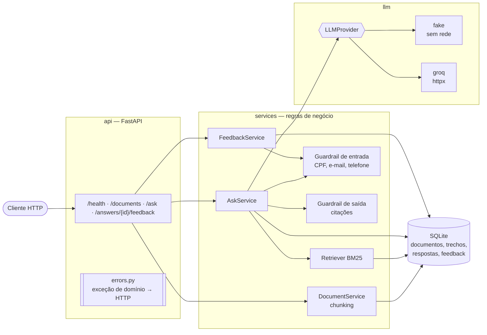

# 🦁 LION API

[](https://github.com/ronenfilho/lion-api/actions/workflows/ci.yml)
[](https://github.com/ronenfilho/lion-api/releases)
[](pyproject.toml)
[](LICENSE)

API REST que responde dúvidas sobre **IRPF** com base em fontes oficiais, citando os trechos usados e aplicando guardrails contra alucinação e vazamento de dados pessoais.

MVP derivado do projeto de pesquisa [LION](https://github.com/ronenfilho/lion), feito como mini-projeto do Módulo 4 da especialização AKCIT/UFG *Engenharia de Software: Automação e Inovação com IA Generativa*. Versão atual: **1.0.0** ([CHANGELOG](CHANGELOG.md)).

## Problema e solução

**Problema:** um LLM genérico responde perguntas de imposto de renda com confiança, mas sem dizer de onde tirou a informação, e pode inventar valores, prazos e artigos. O usuário ainda tende a colar CPF, e-mail ou telefone na pergunta.

**Solução:** uma API de RAG enxuta, que:

- indexa documentos oficiais em texto (leis, instruções normativas, perguntas e respostas da Receita Federal);
- recupera os trechos mais relevantes por **BM25** e pede ao LLM uma resposta **só com base neles**, citando cada trecho como `[n]`;
- confere as citações na saída: citação que não aponta para trecho recuperado é removida; resposta sem nenhuma citação válida vira "não encontrei base nas fontes";
- bloqueia CPF, e-mail e telefone **antes** de buscar, chamar o LLM ou gravar;
- devolve os trechos encontrados, em vez de erro, se o LLM falhar;
- registra feedback (útil / não útil) de cada resposta.

## Arquitetura



Camadas `api` → `services` → `repositories`, com `schemas` (Pydantic) e `llm` (provedores intercambiáveis). A aplicação é montada por `create_app(settings, provider)`, o que deixa banco e provedor injetáveis nos testes. Fluxo do `/ask` passo a passo e tabela de erros em [docs/arquitetura.md](docs/arquitetura.md); o motivo de cada escolha em [docs/decisoes.md](docs/decisoes.md).

## Stack

Python 3.11+ · FastAPI · Pydantic v2 · SQLite (`sqlite3` da biblioteca padrão) · BM25 (`rank-bm25`) · LLM via Groq com `httpx` (ou provedor `fake`, determinístico e sem rede) · pytest + HTTPX · Ruff · GitHub Actions · Docker

## Como rodar

Requisitos: Python 3.11 ou 3.12 com `venv` (no Debian/Ubuntu, pacote `python3-venv`), `make` e, opcionalmente, Docker. Testado em macOS e Linux.

### Com Makefile

```bash
git clone https://github.com/ronenfilho/lion-api.git && cd lion-api
make install                 # cria .venv e instala requirements-dev.txt
cp .env.example .env         # opcional: sem .env a API usa o provedor fake
make run                     # http://127.0.0.1:8000 (Swagger em /docs)
```

Em outro terminal, carregue o corpus de exemplo (trechos das Leis 9.250/1995 e 7.713/1988, em `data/sample/`):

```bash
make load-sample
```

`make` sem alvo lista todos os alvos (`install`, `run`, `test`, `lint`, `format`, `load-sample`, `docker-build`, `docker-run`, `clean`). Para outra porta: `make run PORT=8080` e `make load-sample BASE_URL=http://localhost:8080`.

Sem make, os comandos equivalentes são:

```bash
python3 -m venv .venv && source .venv/bin/activate
pip install -r requirements-dev.txt     # só para executar: requirements.txt
uvicorn app.main:app --reload
python scripts/load_sample.py           # em outro terminal
```

### Com Docker

```bash
make docker-build            # imagem lion-api:1.0.0 (python:3.12-slim, usuário sem privilégios)
make docker-run              # porta 8000; banco em /data, no volume lion-data; usa o .env se existir
docker exec lion-api python scripts/load_sample.py
```

A imagem traz só as dependências de execução, tem `HEALTHCHECK` no `/health` e grava o SQLite em `/data/lion.sqlite3` (`DATABASE_PATH`). Sem make: `docker build -t lion-api .` e `docker run --rm --name lion-api -p 8000:8000 -v lion-data:/data lion-api` (acrescente `--env-file .env` para usar o `.env`).

## Testes e qualidade

```bash
make test     # pytest: 83 testes, sem rede, sem .env e sem o banco de var/
make lint     # ruff check + ruff format --check
make format   # aplica a formatação e as correções automáticas
```

O [CI](.github/workflows/ci.yml) roda lint e testes em Python 3.11 e 3.12 a cada push e pull request e, em seguida, constrói a imagem Docker e faz um smoke test nela (`/health`, carga do corpus e `/ask`).

A suíte cobre CRUD de documentos, `/ask` com o provedor `fake`, guardrails de entrada e saída, feedback, `AskService` isolado com dublês, `GroqProvider` com HTTP simulado (`httpx.MockTransport`), configuração por ambiente e as rotas registradas em `app.main.app`, o objeto servido pelo uvicorn.

## Endpoints

| Método | Rota | Descrição |
|---|---|---|
| GET | `/health` | Status da API |
| POST | `/documents` | Indexa um documento em texto (201) |
| GET | `/documents` | Lista documentos |
| GET | `/documents/{id}` | Detalha um documento (404 se não existir) |
| DELETE | `/documents/{id}` | Remove documento e trechos (204; 404 se não existir) |
| POST | `/ask` | Responde com base nos trechos recuperados, com citações (422 se houver dado pessoal) |
| POST | `/answers/{answer_id}/feedback` | Registra se a resposta foi útil (201; 404 se a resposta não existir) |

Documentação interativa em `/docs` (Swagger) e contrato em `/openapi.json`.

### Exemplos

```bash
curl -s localhost:8000/health
# {"status":"ok","timestamp":"2026-10-15T18:52:23.871477Z"}

curl -s -X POST localhost:8000/documents -H 'content-type: application/json' -d '{
  "title": "Lei nº 9.250/1995 — Art. 8º",
  "source": "https://www.planalto.gov.br/ccivil_03/leis/l9250.htm",
  "content": "Art. 8º A base de cálculo do imposto devido no ano-calendário será a diferença entre..."
}'
# 201 {"id":3,"title":"Lei nº 9.250/1995 — Art. 8º","source":"...","chunk_count":1,"created_at":"..."}

curl -s -X POST localhost:8000/ask -H 'content-type: application/json' \
  -d '{"question": "Qual o limite de dedução com educação?"}'
```

Resposta (provedor `fake`, com o corpus de exemplo carregado; textos encurtados):

```json
{
  "answer_id": 1,
  "answer": "Segundo as fontes, b) a pagamentos de despesas com instrução do contribuinte e de seus dependentes, [...] [1]",
  "grounded": true,
  "citations": [
    {
      "document_id": 2,
      "document_title": "Lei nº 9.250/1995 — Art. 8º (base de cálculo e deduções da declaração anual)",
      "chunk_id": 6,
      "excerpt": "b) a pagamentos de despesas com instrução do contribuinte e de seus dependentes, [...]",
      "score": 3.8477
    }
  ],
  "provider": "fake"
}
```

No texto, `[i]` corresponde a `citations[i-1]`. O campo opcional `top_k` (1 a 10) define quantos trechos são recuperados; sem ele vale `DEFAULT_TOP_K`. Com `LLM_PROVIDER=groq` e chave configurada, a resposta é redigida pelo modelo, com as mesmas regras de citação.

```bash
# Pergunta com dado pessoal: bloqueada antes do LLM e do banco, sem ecoar o dado
curl -s -X POST localhost:8000/ask -H 'content-type: application/json' \
  -d '{"question": "Meu CPF é 123.456.789-09, tenho restituição?"}'
# 422 {"detail":"Bloqueado: o campo 'pergunta' parece conter dado pessoal (CPF). A LION API não processa CPF, e-mail ou telefone; remova o dado e envie novamente."}

# Feedback sobre uma resposta (answer_id devolvido pelo /ask)
curl -s -X POST localhost:8000/answers/1/feedback -H 'content-type: application/json' \
  -d '{"useful": true, "comment": "Resposta clara."}'
# 201 {"id":1,"answer_id":1,"useful":true,"comment":"Resposta clara.","created_at":"..."}

curl -s localhost:8000/documents/99
# 404 {"detail":"Documento 99 não encontrado."}
```

Erros de regra de negócio seguem `{"detail": "mensagem"}` (404 para documento ou resposta inexistente, 422 para dado pessoal); erros de validação do payload usam o 422 padrão do FastAPI.

## Configuração

Variáveis lidas do ambiente ou do `.env` (modelo em [`.env.example`](.env.example)). Variável vazia usa o padrão; valor inválido impede a API de subir, com mensagem que nomeia a variável.

| Variável | Padrão | Descrição |
|---|---|---|
| `LLM_PROVIDER` | `fake` | `groq` ou `fake`. Com `groq` e sem chave, cai para `fake` (com aviso no log) |
| `GROQ_API_KEY` | vazio | Chave da Groq. Só no `.env`, nunca no repositório |
| `GROQ_MODEL` | `llama-3.1-8b-instant` | Modelo usado na Groq |
| `LLM_TIMEOUT_SECONDS` | `20` | Timeout da chamada ao LLM (maior que zero) |
| `DATABASE_PATH` | `var/lion.sqlite3` | Arquivo SQLite (no Docker: `/data/lion.sqlite3`) |
| `DEFAULT_TOP_K` | `4` | Trechos recuperados quando a pergunta não informa `top_k` (1 a 10) |
| `CHUNK_MAX_CHARS` | `800` | Tamanho máximo de cada trecho na ingestão (100 a 4000) |

## Estrutura

```text
app/
  api/            rotas, injeção de dependências e handler central de erros
  services/       ask, documentos, feedback, chunking, BM25 e guardrails
  repositories/   SQLite (esquema e repositórios)
  llm/            contrato LLMProvider, fake, groq, fábrica e prompts
  config.py       Settings validado a partir do ambiente
  schemas.py      contratos Pydantic de entrada e saída
data/sample/      corpus de exemplo (textos legais públicos)
scripts/          carga do corpus de exemplo
tests/            suíte pytest
docs/             escopo, backlog, arquitetura, decisões, demo e checklist de entrega
prompts/          registro dos prompts usados no desenvolvimento
```

## Limites

- **Corpus pequeno e só texto:** a busca BM25 recalcula o índice a cada pergunta (D01) e não entende sinônimos; serve para dezenas de documentos, não milhares. Sem PDF/HTML nem busca semântica.
- **Guardrail de dados pessoais por regex** (D08): cobre CPF, e-mail e telefone brasileiros. Não detecta nome, endereço, RG, CNH nem dados bancários, e pode bloquear números longos que só parecem CPF ou telefone.
- **Guardrail de saída confere a citação, não o conteúdo:** garante que cada `[n]` aponta para um trecho recuperado, mas não que a frase esteja de fato no trecho.
- **Provedor real não validado com chave:** o `GroqProvider` é testado com HTTP simulado (sucesso, timeout, HTTP 500, payload inesperado), não contra a API real.
- **Sem autenticação nem limite de uso:** qualquer cliente pode indexar, apagar documentos e enviar feedback.
- **SQLite numa conexão compartilhada:** adequado para uso local e demonstração, não para carga concorrente.
- **Não é orientação fiscal:** as respostas se limitam aos trechos indexados, que podem estar desatualizados.

## Próximos passos

- Validar o `GroqProvider` com chave real e adicionar um segundo provedor (ex.: Gemini).
- Busca híbrida (BM25 + embeddings) e índice persistente, para corpus maior.
- Ingestão de PDF/HTML da Receita Federal e corpus do IRPF do ano corrente.
- Autenticação por chave de API e limite de requisições; um feedback por usuário.
- Postgres no lugar do SQLite para uso concorrente; métricas e logs estruturados.
- Avaliação automática da qualidade das respostas com um conjunto de perguntas de referência.

## Como a IA foi usada no desenvolvimento

O código, os testes e a documentação foram produzidos com um agente de código (**Claude Code**), sob direção e revisão humana. Todos os pedidos estão registrados em [prompts/](prompts/README.md), no formato CO-STAR (contexto, objetivo, estilo, resposta).

### Onde acelerou

- Estrutura inicial em camadas, schemas, repositórios SQLite e rotas, a partir de critérios de aceite escritos antes ([backlog](docs/backlog.md)).
- Testes em volume: casos parametrizados de guardrail, dublês do `AskService`, HTTP simulado do Groq. Nas regras da 0.2, os testes foram escritos primeiro e rodados no vermelho (TDD).
- Tarefas repetitivas de entrega: Makefile, Dockerfile, CI, CHANGELOG e divisão das mudanças em commits pequenos (Conventional Commits).

### Onde a revisão humana foi decisiva

Bugs reais encontrados na revisão do que o agente gerou, todos corrigidos com teste:

| Problema | Efeito | Correção |
|---|---|---|
| Método `list` do repositório sombreava o tipo `list` nas anotações da própria classe | `TypeError` ao importar | Renomeado para `list_all` (prompt 08) |
| IDF clássico do `BM25Okapi` negativo para termos presentes em metade ou mais dos trechos | Com 1 ou 2 trechos indexados, nenhuma busca retornava nada | IDF do Lucene, sempre positivo (D10) |
| `content: null` na resposta do Groq escapava como `AttributeError` | Erro 500 no `/ask` em vez do fallback | Toda resposta sem texto vira `LLMError` (D12) |
| Teste de "ordenação" com um só trecho relevante; teste de remoção que não olhava o índice | Testes verdes que não testavam o que prometiam | Reescritos; o de remoção revelou o bug do IDF (prompt 11) |
| Citações sem renumeração; citação inválida continuava no texto | `[2]` no texto podia ser o 1º item de `citations` | `check_citations` remove e renumera (D09) |

Na 1.0, a revisão também eliminou a versão duplicada (`pyproject.toml` e `main.py`), trocou um `assert` (que some com `python -O`) pela construção explícita do registro e acrescentou um teste que confere as rotas da aplicação real, porque testes verdes não garantem que todos os routers estão incluídos (lição da aula 5.2).

### Prompts que funcionaram melhor

Pedidos curtos, com um objetivo por vez, restrições explícitas ("sem dependências novas", "regra no serviço, não na rota", "crie o arquivo no repositório"), critérios de aceite com códigos HTTP e a instrução de deixar tudo no working tree para revisão antes do commit.

### Riscos mitigados

- **Segredos:** chaves só no `.env` (ignorado pelo Git), nunca no prompt nem no código; o histórico foi varrido por padrões de chave (`gsk_`, `AIza`, `sk-`, `api_key=`…) antes da entrega, sem ocorrências.
- **Dados pessoais:** guardrail de entrada antes de qualquer processamento; a mensagem de erro não repete o dado.
- **Alucinação:** resposta restrita aos trechos, citações conferidas e resposta padrão quando não há base.
- **Indisponibilidade do LLM:** fallback para os trechos recuperados (D03); testes sem rede com o provedor `fake`.
- **Código gerado sem revisão:** todo diff revisado com `ruff` e `pytest` verdes antes do commit; refatorações separadas de funcionalidades.

## Documentação

- [Escopo do MVP](docs/escopo-mvp.md) · [Backlog por release](docs/backlog.md) · [Arquitetura](docs/arquitetura.md) · [Decisões técnicas](docs/decisoes.md)
- [Roteiro de demonstração](docs/demo.md) · [Checklist de entrega](docs/entrega.md) · [CHANGELOG](CHANGELOG.md) · [Prompts](prompts/README.md)

## Licença

[MIT](LICENSE) © 2026 Ronen Filho.

As respostas são informativas e baseadas apenas nos documentos indexados; não substituem orientação contábil nem da Receita Federal.
