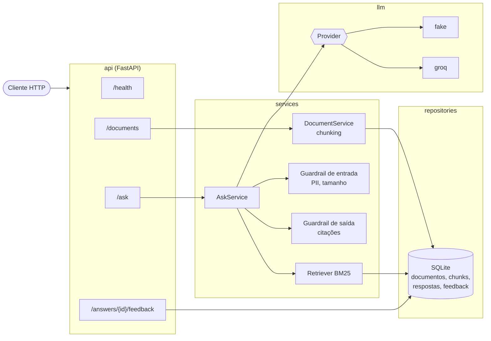

# Arquitetura — LION API

## Fluxo de `POST /ask`

1. A rota valida o payload (Pydantic).
2. O guardrail de entrada rejeita pergunta inválida ou com dados pessoais.
3. O retriever BM25 busca os `k` trechos mais relevantes no SQLite.
4. O provider de LLM gera a resposta com um prompt que exige citar os trechos.
5. O guardrail de saída confere as citações; sem base, devolve a resposta padrão.
6. A resposta é gravada (para receber feedback) e devolvida com as citações.
