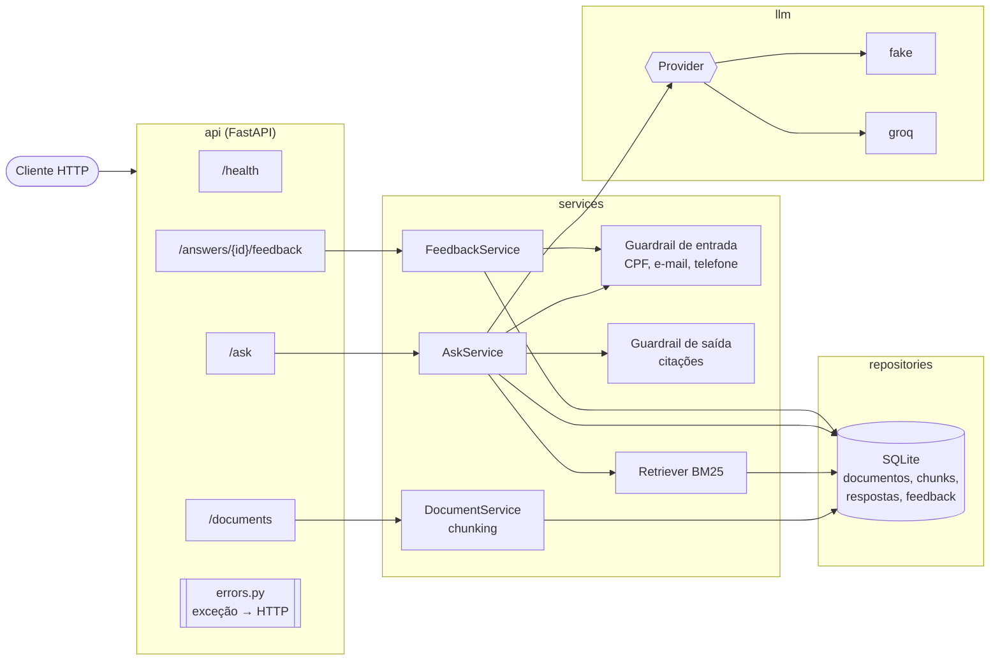

# Arquitetura — LION API

## Fluxo de `POST /ask`

1. A rota valida o payload (Pydantic): pergunta de 3 a 500 caracteres, sem contar espaços nas pontas.
2. O guardrail de entrada rejeita pergunta com CPF, e-mail ou telefone (`SensitiveDataError` → 422), antes de buscar, gerar ou gravar.
3. O retriever BM25 busca os `k` trechos mais relevantes no SQLite.
4. O provider de LLM gera a resposta com um prompt que exige citar os trechos. Se falhar (`LLMError`), devolve os trechos com um aviso.
5. O guardrail de saída descarta citações inexistentes e renumera as válidas; sem nenhuma, devolve a resposta padrão "não encontrei base".
6. A resposta é gravada (para receber feedback) e devolvida com as citações.

## Tratamento de erros

Os serviços levantam exceções de domínio (`app/exceptions.py`) sem conhecer HTTP. A camada de API converte cada família num só lugar (`app/api/errors.py`):

| Exceção | Status | Exemplo de `detail` |
|---|---|---|
| `DocumentNotFoundError` | 404 | `Documento 7 não encontrado.` |
| `AnswerNotFoundError` | 404 | `Resposta 7 não encontrada.` |
| `SensitiveDataError` | 422 | `Bloqueado: o campo 'pergunta' parece conter dado pessoal (CPF). …` |

Erros de validação do payload continuam no formato padrão do FastAPI (422 com a lista de campos).
